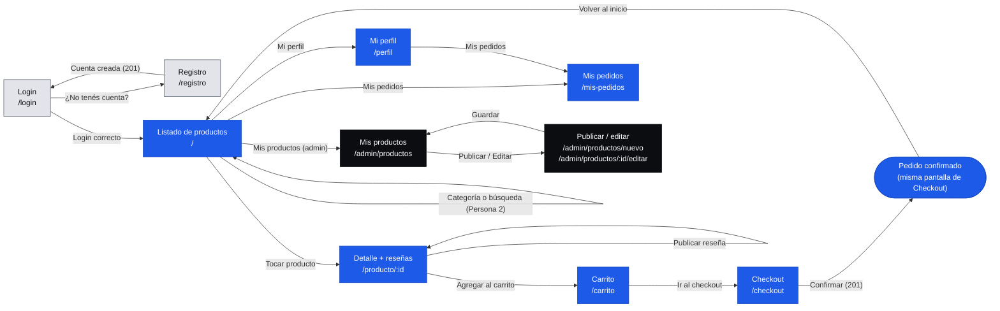

# Wireflow — mapa de navegación

Cómo se pasa de una pantalla a otra. Los colores marcan quién puede entrar:

- **Gris:** pública (sin login)
- **Azul:** necesita login (rol USER o ADMIN)
- **Negro:** solo ADMIN

Diseño de cada pantalla: [`docs/diseño/mockups/`](diseño/mockups/). Este mismo mapa en imagen: [`docs/diseño/wireflow.png`](diseño/wireflow.png).

## Desde cualquier pantalla con login

El encabezado (`Navbar`) está en todas, así que desde cualquiera se puede ir a: listado (logo), el carrito, Mi perfil, Mis pedidos, Mis productos (solo admin) y Cerrar sesión (→ Login).

## Reglas de redirección

| Situación | Qué pasa | Dónde está |
|---|---|---|
| Entra a una pantalla con login sin estar logueado | Va a Login; después de ingresar, vuelve a la pantalla que quería | `src/routes/RutaProtegida.jsx` |
| Un USER entra a `/admin/...` | Va al listado de productos | `src/routes/RutaAdmin.jsx` |
| La URL no existe | Pantalla "Esta página no existe" | `src/pages/NoEncontrada` |

Mientras no esté el Login, las rutas dejan pasar a todos (`PROTEGER_RUTAS = false` en `src/routes/rutas.js`), así cada uno puede probar su pantalla.

La búsqueda y los filtros por categoría están en el mockup, pero cómo se implementan (y si usan parámetros en la URL) lo decide la Persona 2.
